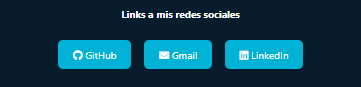

# Portfolio de Matías Sosa

Portfolio personal desarrollado con **HTML y CSS** para presentar mi perfil, experiencia profesional, formación, conocimientos técnicos y medios de contacto.

## Contenido

- Presentación y perfil profesional
- Experiencia laboral
- Stack tecnológico y nivel de experiencia
- Enlaces a GitHub y LinkedIn
- Formulario de contacto

## Tecnologías

- HTML5
- CSS3
- Font Awesome 6.5.1 para los iconos

## Ver el portfolio

Abrí `index.html` en tu navegador para recorrer el sitio localmente. Las imágenes utilizadas se encuentran en `assets/Img/` y los estilos en `css/style.css`.

## Estructura

```text
.
├── assets/
│   └── Img/          # Imágenes y recursos visuales
├── css/
│   └── style.css     # Estilos del sitio
├── index.html        # Página principal
└── README.md
```

## Contacto

- [GitHub](https://github.com/Matias-Agustin-Sosa)
- [LinkedIn](https://www.linkedin.com/in/matias-agustin-sosa)
- [Mi Portfolio](https://matias-agustin-sosa.github.io/Portfolio)

En mi portfolio también podés encontrar links a mis redes sociales en la sección de Experiencia Laboral:

<p align="center">

</p>
